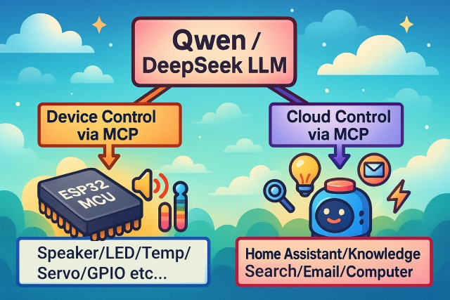
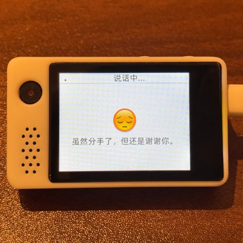
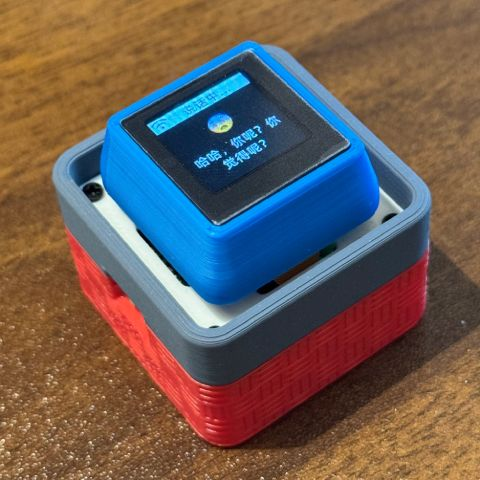
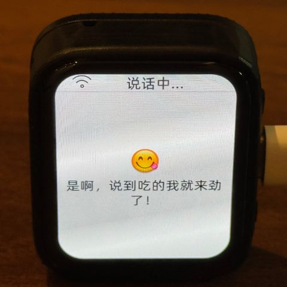
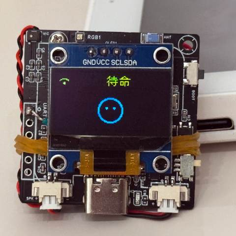
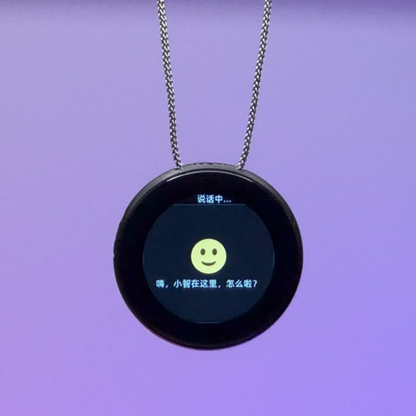
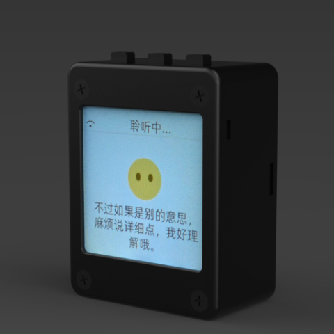
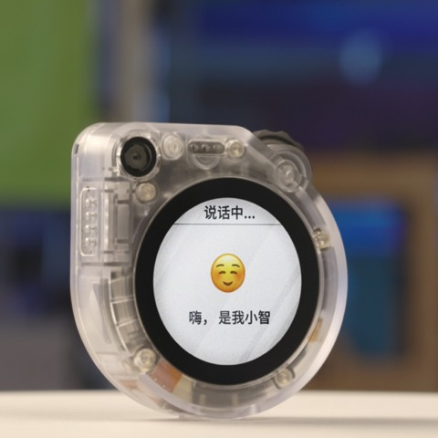
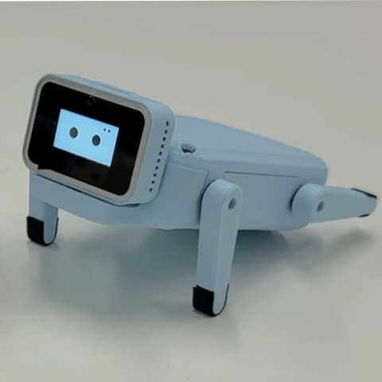

# An MCP-based Chatbot | 一个基于 MCP 的聊天机器人

（中文 | [English](README_en.md) | [日本語](README_ja.md)）

## 视频

👉 [人类：给 AI 装摄像头 vs AI：当场发现主人三天没洗头【bilibili】](https://www.bilibili.com/video/BV1bpjgzKEhd/)

👉 [手工打造你的 AI 女友，新手入门教程【bilibili】](https://www.bilibili.com/video/BV1XnmFYLEJN/)

## 介绍

这是一个由虾哥开源的 ESP32 项目，以 MIT 许可证发布，允许任何人免费使用，或用于商业用途。

我们希望通过这个项目，能够帮助大家了解 AI 硬件开发，将当下飞速发展的大语言模型应用到实际的硬件设备中。

如果你有任何想法或建议，请随时提出 Issues 或加入 QQ 群：1011329060

### 基于 MCP 控制万物

小智 AI 聊天机器人作为一个语音交互入口，利用 Qwen / DeepSeek 等大模型的 AI 能力，通过 MCP 协议实现多端控制。



### 已实现功能

- Wi-Fi / ML307 Cat.1 4G
- 离线语音唤醒 [ESP-SR](https://github.com/espressif/esp-sr)
- 支持两种通信协议（[Websocket](docs/websocket.md) 或 MQTT+UDP）
- 采用 OPUS 音频编解码
- 基于流式 ASR + LLM + TTS 架构的语音交互
- 声纹识别，识别当前说话人的身份 [3D Speaker](https://github.com/modelscope/3D-Speaker)
- OLED / LCD 显示屏，支持表情显示
- 电量显示与电源管理
- 支持多语言（中文、英文、日文）
- 支持 ESP32-C3、ESP32-S3、ESP32-P4 芯片平台
- 通过设备端 MCP 实现设备控制（音量、灯光、电机、GPIO 等）
- 通过云端 MCP 扩展大模型能力（智能家居控制、PC桌面操作、知识搜索、邮件收发等）

## 🌱 植语 — 基于小智 AI 的智能绿植养护二次开发

> 本项目基于 **xiaozhi-esp32 v1.9.4** 开源框架二次开发，面向 ESP32-S3 粤嵌（GEC）开发板，
> 构建了一个名为 **「植语（PlantTalk）」** 的 AI 语音交互智能绿植养护系统。
> 核心定位：让用户用**自然语言**（或触摸）管理家里的绿植，由 AI 自动或远程完成浇水、补光等养护动作。

### 新增功能

1. **植物数据看板 + AI 聊天双界面**（LVGL v9）
   - 深绿主题 2×2 卡片看板：土壤湿度 / 光照 / 温度 / 湿度实时显示
   - 触摸全屏点击、或语音唤醒词，双通道在"看板 ↔ 聊天"之间互切
   - 养护状态自动循环滚动（`LV_LABEL_LONG_MODE_SCROLL_CIRCULAR`）
2. **自动养护闭环**：土壤湿度 < 20% 自动浇水、光照 < 15% 自动补光，30 秒冷却防振荡
3. **MCP 协议设备侧工具链**：新增 7 个绿植专属 MCP 工具（浇水/补光/状态查询/历史/自动养护开关/演示设值/健康检查），AI 可直接调用硬件能力
4. **巴法云远程 TCP 控制**（bemfa.com:8344）：支持 HTTP 指令码（1=上报/2=浇水/3=补光）、60 秒心跳、断线重连、自动丢弃回显消息防止循环浇水
5. **摄像头 AI 健康诊断**：GC0308 传感器 + PCA9557 I²C 电源扩展，单次拍照 JPEG 上传服务器
6. **养护日志环形缓冲**（20 条，来源标签：语音调用 / 自动触发 / 远程触发）

### 新增 / 修改文件一览

**新增自研模块**：
| 文件 | 作用 |
|---|---|
| `main/plant_monitor.h / .cc` | 植物数据引擎：土壤湿度 / 光照虚拟模型、自动养护阈值、环形养护日志 |
| `main/bemfa_cloud.h / .cc` | 巴法云 TCP 客户端：订阅/发布/60 秒心跳/断线重连/DNS 重试 |
| `main/dht11_sensor.h / .cc` | DHT11 温湿度传感器，数据接入 MCP 工具链 |
| `main/led_ctrl.h / .cc` | GPIO10 LED 状态指示（浇水 / 补光） |

**修改的原有框架文件**：
| 文件 | 改动内容 |
|---|---|
| `main/application.cc` | 启动时初始化新模块；主事件循环每秒 Tick() 刷新数据；巴法云任务挂载于 `StartNetwork()` 之后；MCP 工具注册 |
| `main/application.h` | 新增 `PlantMonitor` / `Dht11Sensor` / `led_ctrl` / `BemfaCloud` 成员 |
| `main/display/display.h` | 新增 `ShowPlantDashboard()` / `ShowChatScreen()` / `UpdatePlantDashboard()` 虚接口 |
| `main/display/lcd_display.h / .cc` | 实现深绿主题看板 UI、触摸切换、循环滚动状态文本 |
| `main/mcp_server.cc` | 注册 7 个绿植专属 MCP 工具 |
| `main/boards/gec-esp32s3-board/gec_esp32s3_board.cc` | 启用触摸初始化 |
| `main/CMakeLists.txt` | SOURCES 列表追加新模块 |
| `.github/workflows/build.yml` | CI 容器镜像升级到 IDF v5.5（与本地编译环境一致） |

### 构建 / 烧录（Windows + ESP-IDF 5.5.3）

```powershell
# 首次需安装 IDF（v5.5.3，5.4+ 以上均可，实测 5.5.3 稳定）
$env:IDF_TOOLS_PATH='D:\ESP32\EspressifV5.5.3\tools'
& 'D:\ESP32\EspressifV5.5.3\frameworks\esp-idf-v5.5.3\export.ps1'

idf.py -p COM14 flash monitor
```

### 关键约束 & 踩坑记录

1. **TCP/IP 协议栈必须先于网络客户端初始化**：`BemfaCloud::Start()` 必须在 `board.StartNetwork()` 之后，否则 lwIP `tcpip_send_msg_wait_sem (Invalid mbox)` 断言触发 → 设备无限重启
2. **PSRAM 必开**：摄像头帧缓冲依赖 PSRAM，关闭即 Crash
3. **`CONFIG_LIBC_NEWLIB_NANO_FORMAT=y` 下 `%f` 不可用**：看板更新用 `std::ostringstream oss << std::fixed << std::setprecision(1)` 转浮点
4. **巴法云回显循环浇水**：设备发布到 `status` 主题的状态消息会被巴法云回显回来，回显含"土壤湿度:"标记，`HandleLine()` 据此识别丢弃，防止关键词匹配误判为指令

> 更详细的架构说明、模块内部设计、MCP 工具注册清单、自动养护策略、LVGL 多线程安全规范、常见坑的完整复现与修复，请见 [docs/plantalk/README.md](docs/plantalk/README.md)。

---

## 硬件

### 面包板手工制作实践

详见飞书文档教程：

👉 [《小智 AI 聊天机器人百科全书》](https://ccnphfhqs21z.feishu.cn/wiki/F5krwD16viZoF0kKkvDcrZNYnhb?from=from_copylink)

面包板效果图如下：


### 支持 70 多个开源硬件（仅展示部分）

- <a href="https://oshwhub.com/li-chuang-kai-fa-ban/li-chuang-shi-zhan-pai-esp32-s3-kai-fa-ban" target="_blank" title="立创·实战派 ESP32-S3 开发板">立创·实战派 ESP32-S3 开发板</a>
- <a href="https://github.com/espressif/esp-box" target="_blank" title="乐鑫 ESP32-S3-BOX3">乐鑫 ESP32-S3-BOX3</a>
- <a href="https://docs.m5stack.com/zh_CN/core/CoreS3" target="_blank" title="M5Stack CoreS3">M5Stack CoreS3</a>
- <a href="https://docs.m5stack.com/en/atom/Atomic%20Echo%20Base" target="_blank" title="AtomS3R + Echo Base">M5Stack AtomS3R + Echo Base</a>
- <a href="https://gf.bilibili.com/item/detail/1108782064" target="_blank" title="神奇按钮 2.4">神奇按钮 2.4</a>
- <a href="https://www.waveshare.net/shop/ESP32-S3-Touch-AMOLED-1.8.htm" target="_blank" title="微雪电子 ESP32-S3-Touch-AMOLED-1.8">微雪电子 ESP32-S3-Touch-AMOLED-1.8</a>
- <a href="https://github.com/Xinyuan-LilyGO/T-Circle-S3" target="_blank" title="LILYGO T-Circle-S3">LILYGO T-Circle-S3</a>
- <a href="https://oshwhub.com/tenclass01/xmini_c3" target="_blank" title="虾哥 Mini C3">虾哥 Mini C3</a>
- <a href="https://oshwhub.com/movecall/cuican-ai-pendant-lights-up-y" target="_blank" title="Movecall CuiCan ESP32S3">璀璨·AI 吊坠</a>
- <a href="https://github.com/WMnologo/xingzhi-ai" target="_blank" title="无名科技Nologo-星智-1.54">无名科技 Nologo-星智-1.54TFT</a>
- <a href="https://www.seeedstudio.com/SenseCAP-Watcher-W1-A-p-5979.html" target="_blank" title="SenseCAP Watcher">SenseCAP Watcher</a>
- <a href="https://www.bilibili.com/video/BV1BHJtz6E2S/" target="_blank" title="ESP-HI 超低成本机器狗">ESP-HI 超低成本机器狗</a>

<div style="display: flex; justify-content: space-between;">
  <a href="docs/v1/lichuang-s3.jpg" target="_blank" title="立创·实战派 ESP32-S3 开发板">
    
  </a>
  <a href="docs/v1/espbox3.jpg" target="_blank" title="乐鑫 ESP32-S3-BOX3">
    
  </a>
  <a href="docs/v1/m5cores3.jpg" target="_blank" title="M5Stack CoreS3">
    
  </a>
  <a href="docs/v1/atoms3r.jpg" target="_blank" title="AtomS3R + Echo Base">
    
  </a>
  <a href="docs/v1/magiclick.jpg" target="_blank" title="神奇按钮 2.4">
    
  </a>
  <a href="docs/v1/waveshare.jpg" target="_blank" title="微雪电子 ESP32-S3-Touch-AMOLED-1.8">
    
  </a>
  <a href="docs/v1/lilygo-t-circle-s3.jpg" target="_blank" title="LILYGO T-Circle-S3">
    
  </a>
  <a href="docs/v1/xmini-c3.jpg" target="_blank" title="虾哥 Mini C3">
    
  </a>
  <a href="docs/v1/movecall-cuican-esp32s3.jpg" target="_blank" title="CuiCan">
    
  </a>
  <a href="docs/v1/wmnologo_xingzhi_1.54.jpg" target="_blank" title="无名科技Nologo-星智-1.54">
    
  </a>
  <a href="docs/v1/sensecap_watcher.jpg" target="_blank" title="SenseCAP Watcher">
    
  </a>
  <a href="docs/v1/esp-hi.jpg" target="_blank" title="ESP-HI 超低成本机器狗">
    
  </a>
</div>

## 软件

### 固件烧录

新手第一次操作建议先不要搭建开发环境，直接使用免开发环境烧录的固件。

固件默认接入 [xiaozhi.me](https://xiaozhi.me) 官方服务器，个人用户注册账号可以免费使用 Qwen 实时模型。

👉 [新手烧录固件教程](https://ccnphfhqs21z.feishu.cn/wiki/Zpz4wXBtdimBrLk25WdcXzxcnNS)

### 开发环境

- Cursor 或 VSCode
- 安装 ESP-IDF 插件，选择 SDK 版本 5.4 或以上
- Linux 比 Windows 更好，编译速度快，也免去驱动问题的困扰
- 本项目使用 Google C++ 代码风格，提交代码时请确保符合规范

### 开发者文档

- [自定义开发板指南](main/boards/README.md) - 学习如何为小智 AI 创建自定义开发板
- [MCP 协议物联网控制用法说明](docs/mcp-usage.md) - 了解如何通过 MCP 协议控制物联网设备
- [MCP 协议交互流程](docs/mcp-protocol.md) - 设备端 MCP 协议的实现方式
- [MQTT + UDP 混合通信协议文档](docs/mqtt-udp.md)
- [一份详细的 WebSocket 通信协议文档](docs/websocket.md)

## 大模型配置

如果你已经拥有一个小智 AI 聊天机器人设备，并且已接入官方服务器，可以登录 [xiaozhi.me](https://xiaozhi.me) 控制台进行配置。

👉 [后台操作视频教程（旧版界面）](https://www.bilibili.com/video/BV1jUCUY2EKM/)

## 相关开源项目

在个人电脑上部署服务器，可以参考以下第三方开源的项目：

- [xinnan-tech/xiaozhi-esp32-server](https://github.com/xinnan-tech/xiaozhi-esp32-server) Python 服务器
- [joey-zhou/xiaozhi-esp32-server-java](https://github.com/joey-zhou/xiaozhi-esp32-server-java) Java 服务器
- [AnimeAIChat/xiaozhi-server-go](https://github.com/AnimeAIChat/xiaozhi-server-go) Golang 服务器

使用小智通信协议的第三方客户端项目：

- [huangjunsen0406/py-xiaozhi](https://github.com/huangjunsen0406/py-xiaozhi) Python 客户端
- [TOM88812/xiaozhi-android-client](https://github.com/TOM88812/xiaozhi-android-client) Android 客户端
- [100askTeam/xiaozhi-linux](http://github.com/100askTeam/xiaozhi-linux) 百问科技提供的 Linux 客户端
- [78/xiaozhi-sf32](https://github.com/78/xiaozhi-sf32) 思澈科技的蓝牙芯片固件
- [QuecPython/solution-xiaozhiAI](https://github.com/QuecPython/solution-xiaozhiAI) 移远提供的 QuecPython 固件

## Star History

<a href="https://star-history.com/#78/xiaozhi-esp32&Date">
 <picture>
   <source media="(prefers-color-scheme: dark)" srcset="https://api.star-history.com/svg?repos=78/xiaozhi-esp32&type=Date&theme=dark" />
   <source media="(prefers-color-scheme: light)" srcset="https://api.star-history.com/svg?repos=78/xiaozhi-esp32&type=Date" />
   
 </picture>
</a>
